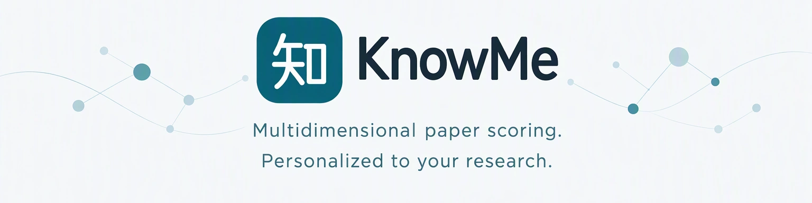
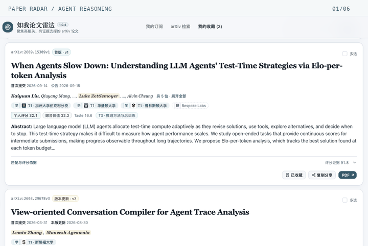

<a href="./README.md">简体中文</a> | English

<a href="https://hackerchenzhuo.github.io/knowme-ai-translate-site/en/">Website ↗</a> · <a href="https://hackerchenzhuo.github.io/knowme-ai-translate-site/en/#guide">Guide</a> · <a href="https://github.com/hackerchenzhuo/knowme-ai-translate-site/issues">Feedback</a>

## Two tools

| Tool | What it does | Install |
|---|---|---|
| **Paper Radar** | Multidimensional scores and reusable cache for a reading list shaped by your research | [Chrome Web Store ↗](https://chromewebstore.google.com/detail/aneomkhamcijmfmeeegocbknklflilof?hl=en) |
| **AI Translate** | Translation within reach, with Markdown structure and your preferred terms preserved | [Chrome Web Store ↗](https://chromewebstore.google.com/detail/ggbnigoglmfkdfmjggiifmfoinncblgm?hl=en) |

Free to install. AI Translate uses your own model connection; provider fees may apply.

## Your research. Your ranking.

Relevance, author and institutional evidence, recency and your interests are weighted in layers to shape your reading order. Personal weights adapt as your research interests and the evidence change. [Explore scoring and the research map ↗](https://hackerchenzhuo.github.io/knowme-ai-translate-site/en/#ranking)

<a href="https://hackerchenzhuo.github.io/knowme-ai-translate-site/en/#experience">Explore the interface ↗</a>

Public paper examples illustrate the tools and do not imply author or institution endorsement.

## Help shape the tools

Independently maintained and freely shared. Found a rough edge or have an idea? Leave a note in [Issues](https://github.com/hackerchenzhuo/knowme-ai-translate-site/issues).

[Updates](https://hackerchenzhuo.github.io/knowme-ai-translate-site/en/#updates) · [Paper Radar privacy](https://hackerchenzhuo.github.io/knowme-ai-translate-site/radar-privacy.html#english) · [AI Translate privacy](https://hackerchenzhuo.github.io/knowme-ai-translate-site/privacy.html#english)
