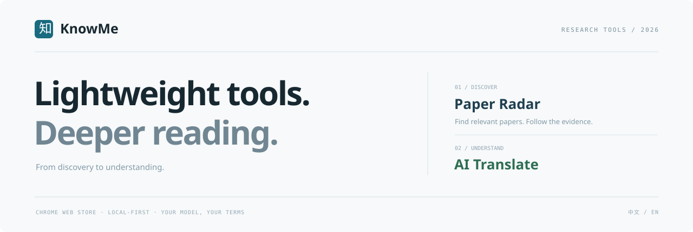
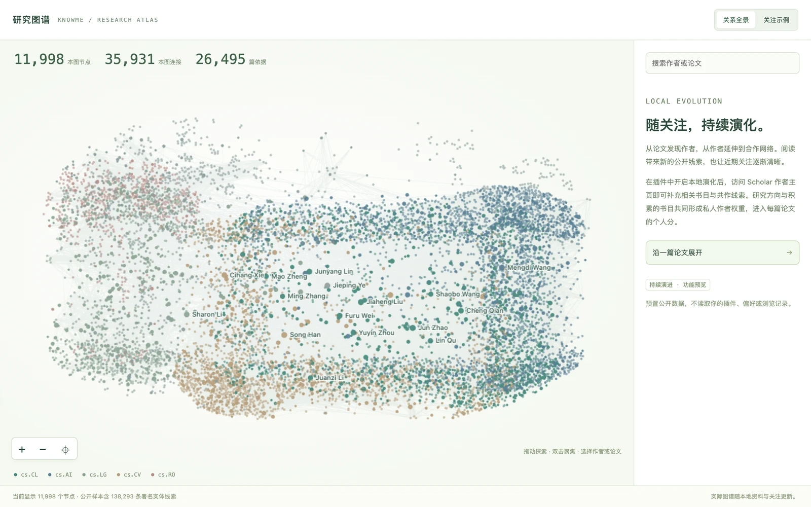

<p align="center"></p>

<p align="center"><strong>发现文献，读懂邮件与文档。</strong><br>两款免费安装的 Chrome 插件，融入研究与日常工作。</p>

<p align="center">
  <a href="https://hackerchenzhuo.github.io/knowme-ai-translate-site/"></a>
  <a href="https://hackerchenzhuo.github.io/knowme-ai-translate-site/en/"></a>
  <a href="https://github.com/hackerchenzhuo/knowme-ai-translate-site/issues/new?template=feature_request.yml"></a>
  <a href="https://github.com/hackerchenzhuo/knowme-ai-translate-site/issues/new?template=bug_report.yml"></a>
</p>

## 两款工具，各有所长

| | 论文雷达 · Paper Radar | AI 翻译 · AI Translate |
|---|---|---|
| 为你做什么 | 按研究方向发现论文，逐项查看作者、机构与评分依据 | 划词或复制后快捷唤起，轻巧浮窗随用随收 |
| 日常体验 | 聚焦相关文献，在 arXiv 原页继续阅读 | 读邮件、看文档，翻译融入手头的工作 |
| 细节 | 专题筛选、作者线索、机构溯源、收藏与分享 | Markdown 结构、个人译法、翻译记忆与缓存 |
| 安装与更新 | [Chrome 商店 ↗](https://chromewebstore.google.com/detail/aneomkhamcijmfmeeegocbknklflilof) | [Chrome 商店 ↗](https://chromewebstore.google.com/detail/ggbnigoglmfkdfmjggiifmfoinncblgm) |
| 产品详情 | [了解论文雷达 ↗](https://hackerchenzhuo.github.io/knowme-ai-translate-site/radar/) | [了解 AI 翻译 ↗](https://hackerchenzhuo.github.io/knowme-ai-translate-site/translate/) |
| 费用 | 免费安装，无需模型 Key | 免费安装，自备模型 Key；模型服务可能计费 |

## 好用的细节，来自真实使用

欢迎在 [Issues](https://github.com/hackerchenzhuo/knowme-ai-translate-site/issues) 留言。一个不顺手的操作、一个没照顾到的场景，都能成为下一次改进的起点。

- **[提出功能建议](https://github.com/hackerchenzhuo/knowme-ai-translate-site/issues/new?template=feature_request.yml)**：告诉我们你在做什么、哪一步有阻力，以及希望怎样更顺手。
- **[报告使用问题](https://github.com/hackerchenzhuo/knowme-ai-translate-site/issues/new?template=bug_report.yml)**：提供产品版本、复现步骤与预期结果，便于定位。
- **[参与已有讨论](https://github.com/hackerchenzhuo/knowme-ai-translate-site/issues)**：在相关 Issue 下补充场景，或用 👍 表达支持。中文、English 都欢迎。

Issues 是公开的；截图请隐去 Key、私人文档与个人信息。无需提供插件内核源码。

## 看看实际效果

论文雷达直接展示 Chrome 商店原图：RRSI 论文详情、评分构成、机构溯源与网页标注。AI 翻译使用包含多级标题、嵌套列表、超链接、表格和代码的 Markdown 笔记，展示结构保留与个人译法。

<p align="center"><a href="https://hackerchenzhuo.github.io/knowme-ai-translate-site/#experience"></a></p>

<p align="center"><a href="https://hackerchenzhuo.github.io/knowme-ai-translate-site/#experience">打开交互演示 ↗</a></p>

## 下一版预览 · 个人分与研究图谱

从论文发现作者，沿合作关系拓展视野。[探索持续演化的研究图谱](https://hackerchenzhuo.github.io/knowme-ai-translate-site/#research-atlas)，让公开线索逐渐汇成自己的研究脉络。

论文雷达下一版预览：复用已完成的筛选，首批论文先出现，剩余结果按进度载入；可停止并保留已显示内容。作者与机构在私人研究体系中的权重，随研究方向与公开书目变化。用 [三个真实论文案例](https://hackerchenzhuo.github.io/knowme-ai-translate-site/#personal-ranking-preview) 查看预计算结果、自动关键词与来源；身份或书目依据不足时保持中性。

研究图谱采用预计算布局、视区裁剪与按需展开。图中数量对应当前公开样本，署名节点不等同于已核验的独立作者。可选的本地演化、查询缓存自动整理均可关闭；论文原件、收藏和固定查询保留。插件的正式可用功能以 Chrome 商店发布版本为准。

公开案例仅作功能演示，不代表作者或机构对产品的认可、合作或背书。

<p align="center"><a href="https://hackerchenzhuo.github.io/knowme-ai-translate-site/#research-demo"></a></p>

个人分由已存证据与研究偏好自动计算，无需逐篇打分；基础证据分单独保留。官网的偏好切换使用预计算的公开样本，只展示计算结果。插件内核与评分引擎保持私有。

## English

**Paper Radar** helps you discover research and inspect the evidence behind each match. **AI Translate** brings translation into emails, documents and everyday work through text selection, shortcuts and a compact window. Both extensions are free to install; AI Translate uses your own model connection, and provider fees may apply.

Start at the [KnowMe website](https://hackerchenzhuo.github.io/knowme-ai-translate-site/en/), with both tools, demos and installation links in one place. For more detail, visit [Paper Radar](https://hackerchenzhuo.github.io/knowme-ai-translate-site/en/radar/) or [AI Translate](https://hackerchenzhuo.github.io/knowme-ai-translate-site/en/translate/). Have an idea or a rough edge to share? [Suggest a feature](https://github.com/hackerchenzhuo/knowme-ai-translate-site/issues/new?template=feature_request.yml), [report a problem](https://github.com/hackerchenzhuo/knowme-ai-translate-site/issues/new?template=bug_report.yml), or add your experience to an existing issue. Please remove keys and private information from public reports.

Preview [personal scores and the Research Atlas](https://hackerchenzhuo.github.io/knowme-ai-translate-site/en/#research-atlas). Version 1.0.4 uses your research interests and stored bibliography to calculate private author weights, which contribute to each paper’s personal score. [Switch perspectives on the same RRSI paper](https://hackerchenzhuo.github.io/knowme-ai-translate-site/en/#personal-ranking-preview). Optional local evolution adds public bibliography and coauthorship evidence from Scholar profiles you visit. You can pause or clear it; map counts describe the current view. Released features depend on the version available in the Chrome Web Store.

Personal scores are calculated automatically from stored evidence and research preferences, without paper-by-paper ratings. Base evidence scores remain separately available. The public preview switches precomputed outputs; extension engines remain private.

## 使用与隐私

- [AI 翻译使用指南](https://hackerchenzhuo.github.io/knowme-ai-translate-site/help.html) · [更新记录](https://hackerchenzhuo.github.io/knowme-ai-translate-site/#updates)
- [论文雷达隐私说明](https://hackerchenzhuo.github.io/knowme-ai-translate-site/radar-privacy.html) · [AI 翻译隐私说明](https://hackerchenzhuo.github.io/knowme-ai-translate-site/privacy.html)

本仓库公开官网展示页、预置演示与说明文档。插件内核与引擎保存在独立私有仓库；安装和更新统一通过 Chrome 商店。

<details>
<summary>Website source</summary>

Buildless HTML, CSS and JavaScript. Preview from the repository root with a static HTTP server.

```text
index.html           中文官网
en/index.html        English website
radar/               论文雷达产品页
translate/           AI 翻译产品页
en/radar/            Paper Radar product page
en/translate/        AI Translate product page
paper-radar/         论文雷达兼容入口
ai-translate/        AI 翻译兼容入口
app.js               Shared public product tour
style.css            Shared presentation
help.html            AI Translate user guide
privacy.html         AI Translate privacy
radar-privacy.html   Paper Radar privacy
assets/              Public product visuals
```

The website uses original public screenshots and prewritten translation examples. It does not run extension engines or make model requests. Original help and privacy URLs remain available.

</details>
